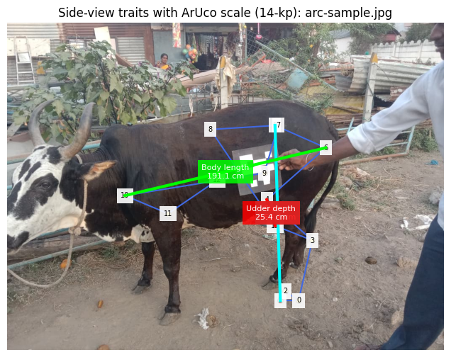
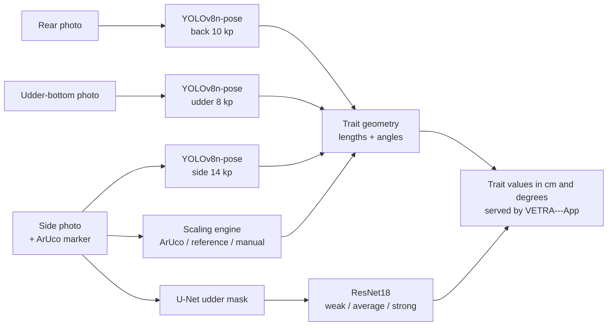
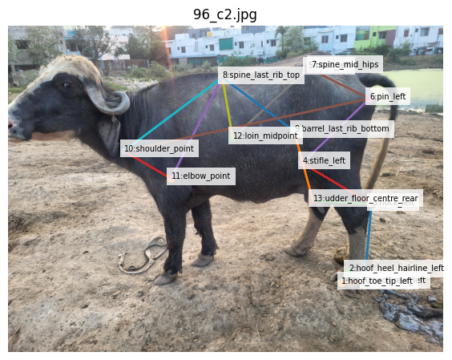
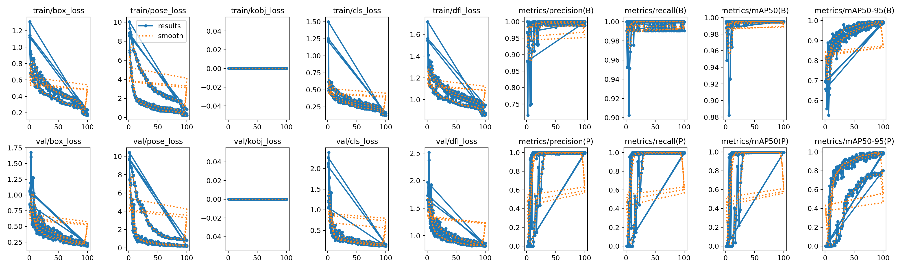
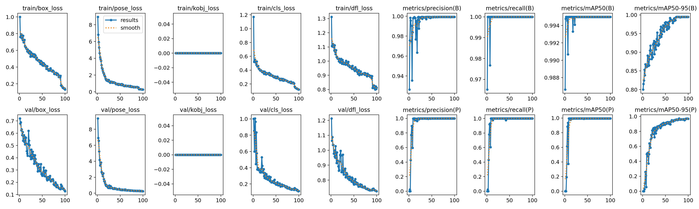
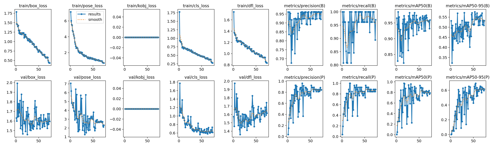
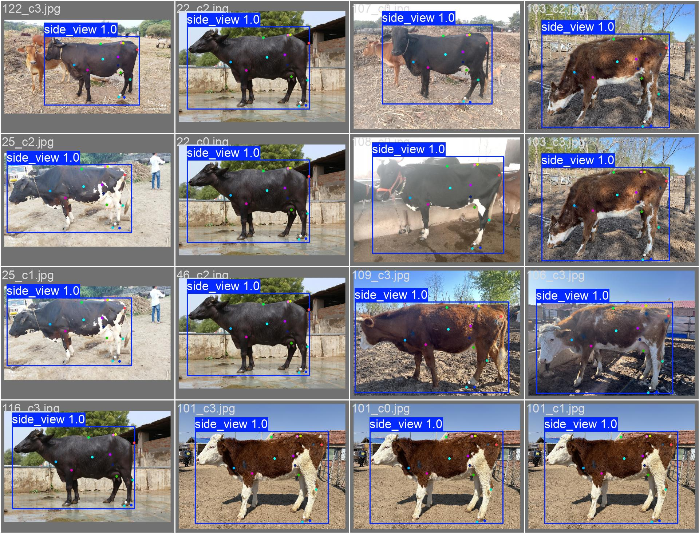
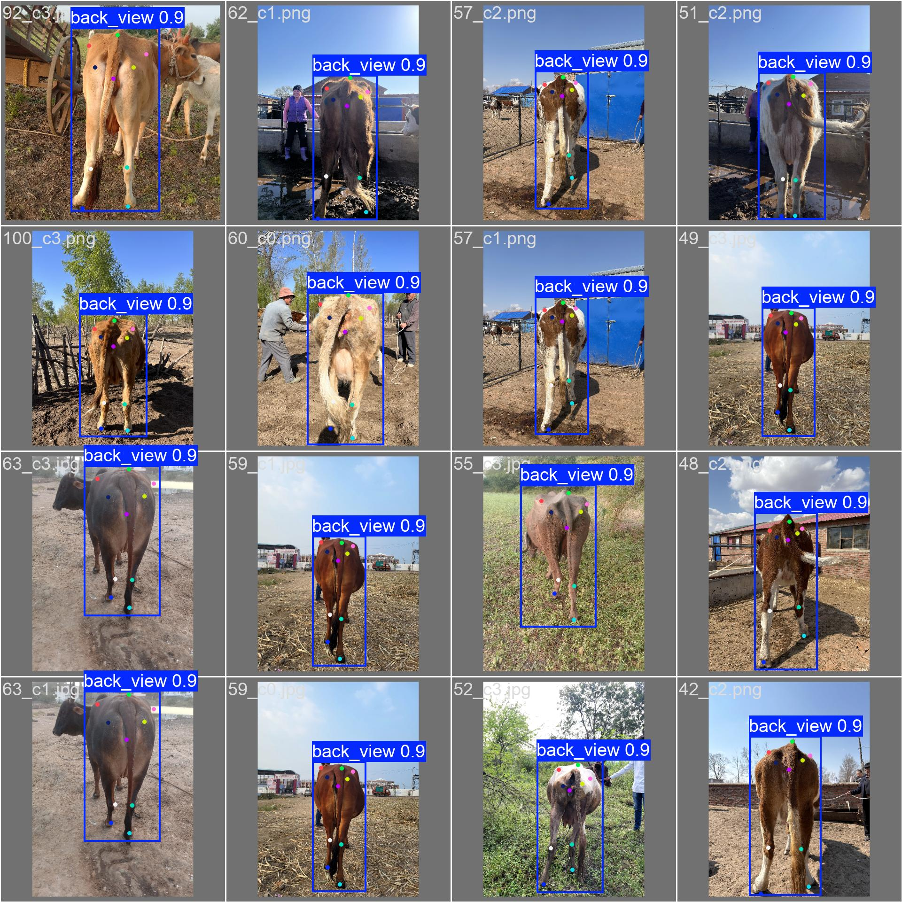
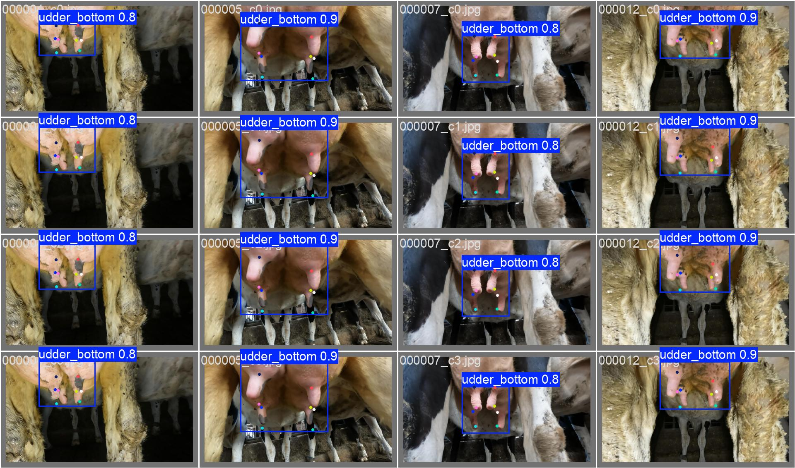

# VETRA v3.0 — Final pose models, ArUco scaling and udder analysis

Final ML training repository for **VETRA (Vision-Enabled Type Recording Assistant)**, an SIH 2025 Grand Finale (Top 5) system for AI-assisted type classification of cattle and buffalo. It trains three YOLOv8n-pose models (**side 14 kp, back 10 kp, udder-bottom 8 kp**) and a U-Net + ResNet18 pair for udder analysis. A tiered **ArUco-first scaling engine** turns pixels into centimetres. The side, back and udder-bottom `best.pt` weights here are the ones served by [VETRA---App](https://github.com/rupeshbharambe24/VETRA---App).


<p align="center">
  
</p>

## Contents

- [Overview](#overview)
- [What's new in this version](#whats-new-in-this-version)
- [Pipeline](#pipeline)
- [Keypoint schemes](#keypoint-schemes)
- [Results](#results)
- [Caveats](#caveats)
- [Project structure](#project-structure)
- [Getting started](#getting-started)
- [Dataset](#dataset)
- [VETRA project map](#vetra-project-map)
- [License](#license)

## Overview

**Problem.** Animal Type Classification (ATC) under NDDB / Rashtriya Gokul Mission guidelines scores linear traits such as stature, body length, heart girth, rump angle, rear-leg set and udder depth. Manual scoring is slow and varies between assessors.

**Approach.** Anatomically named keypoints are predicted per view. Trait lengths and angles are measured between keypoints and converted to cm with a printed ArUco marker in the frame. Udder traits get a separate segmentation and classification pair.

**Highlights**
- **Three pose models with named landmarks.** Side (hoof, hock, stifle, hook, pin, spine, last rib, shoulder, elbow, loin, udder floor), back (hooves, hocks, pins, hooks, tail head, vulva) and udder-bottom (four teats × tip/base).
- **Five-tier scaling engine** (`notebooks/scaling-engine.ipynb`), tried in order: ArUco marker → known reference objects (A4, 30 cm ruler, ID card) → manual two-point → distance/device calibration → carry-over from the previous frame. Each result carries a confidence value.
- **Trait mapping.** Keypoint pairs map to stature, heart girth, body length, body depth, angularity, rump angle, rear-legs set, foot angle, udder depth and BCS proxies (side view), plus rump width/angle and rear-leg view (back).
- **Udder analysis.** A U-Net (ResNet34 encoder, `segmentation-models-pytorch`) segments the udder, and a ResNet18 classifies udder strength as weak, average or strong.
- **Dataset tooling** in `scripts/`: CVAT-XML to YOLO conversion, image/label cleaning, renaming, flipping, JPG conversion.

## What's new in this version

Changes since [VETRA-v2.2-with-app](https://github.com/rupeshbharambe24/VETRA-v2.2-with-app):

| | v2.x | v3.0 |
|---|---|---|
| Side keypoints | 10 unnamed points | **14 named anatomical landmarks** (plus a 16-kp experiment) |
| Back keypoints | 8 | **10** (adds tail head, vulva, both hooves/hocks) |
| Udder | – | **udder-bottom pose (8 kp), udder segmentation U-Net, udder-strength classifier** |
| Pixel to cm | per-measurement factors fitted to the dataset | **physical reference**: ArUco marker first, then fallbacks |
| Traits | 12 raw measurements | NDDB-style traits incl. angles (rump angle, rear-legs set, foot angle, angularity) |
| Breed classifier | synthetic-data prototype | dropped; the focus moved to measurable traits |
| Data prep | in-notebook split | standalone cleaning/conversion scripts, 4× copy augmentation |

## Pipeline



## Keypoint schemes

<details>
<summary>Side view (14 keypoints)</summary>

| # | Name | # | Name |
|---|---|---|---|
| 0 | hoof_rear_left | 7 | spine_mid_hips |
| 1 | hoof_toe_tip_left | 8 | spine_last_rib_top |
| 2 | hoof_heel_hairline_left | 9 | barrel_last_rib_bottom |
| 3 | hock_left | 10 | shoulder_point |
| 4 | stifle_left | 11 | elbow_point |
| 5 | hook_left | 12 | loin_midpoint |
| 6 | pin_left | 13 | udder_floor_centre_rear |

Example traits: stature = 7→0, body length = 10→6, body depth = 8→9, heart-girth proxy = 8→11, rump angle = 5→6, udder depth = 13→3.



</details>

<details>
<summary>Back view (10 keypoints) and udder-bottom (8 keypoints)</summary>

Back: `hoof_rear_left, hoof_rear_right, hock_left, hock_right, pin_left, pin_right, hook_left, hook_right, tail_head, vulva_bottom`.

Udder-bottom: `front_left_tip, front_left_base, front_right_tip, front_right_base, rear_left_tip, rear_left_base, rear_right_tip, rear_right_base`.

</details>

## Results

All numbers below are copied from notebook outputs and `runs/*/results.csv` (RTX 3050 Ti Laptop GPU, Ultralytics 8.3.203). **Read the [caveats](#caveats) before comparing them.**

| Model (run) | Base images | Train / val | Epochs | Val box mAP50 / 50-95 | Val pose mAP50 / 50-95 |
|---|---|---|---|---|---|
| Side 14 kp (`runs/side_view/yolo_pose_side_v1`) | 126 | 403 / 101 (4× copies) | 100 | 0.995 / 0.994 | 0.995 / 0.994 |
| Back 10 kp (`runs/back_view/yolo_pose_back_v1`) | 111 | 355 / 89 (4× copies) | 100 (best at 80) | 0.995 / 0.995 | 0.995 / 0.972 |
| Udder-bottom 8 kp (`runs/udder_bottom_view/yolo_pose_udder_bottom_v1`) | 131 | 104 / 27 images → 416 / 108 copies | 74 (best at 54) | 0.951 / 0.565 | 0.887 / 0.682 |
| Side 16 kp experiment (`runs/side_view/vetra_pose_side_16kp`) | – | – | 100 (last epoch) | 0.995 / 0.991 | 0.995 / 0.802 |
| Udder U-Net, ResNet34 encoder (`models/udder/udder_seg_best.pth`) | 39 | ~32 / 7 | 50 | best val IoU **0.891** | – |
| Udder-strength ResNet18, 3 classes (`models/udder/udder_cls_best.pth`) | 39 | ~32 / 7 | 50 | best val accuracy **0.857** | – |

`runs/side_view/vetra_pose_side_v1` is an 11-epoch run started from `scripts/vetra_side_training.py` that was stopped early. It is kept for completeness.

**ArUco example** (`assets/samples/arc-sample.jpg`, 7 cm `DICT_4X4_50` marker, 0.389 cm/px): stature 162.4 cm, heart-girth proxy 174.6 cm, body length 191.1 cm, body depth 89.0 cm, udder depth 25.4 cm. This is a single image with no tape-measured ground truth, so it shows the pipeline working, not its accuracy.

<details>
<summary>Training curves</summary>

| Side 14 kp | Back 10 kp | Udder-bottom 8 kp |
|---|---|---|
|  |  |  |
|  |  |  |

</details>

<details>
<summary>Udder segmentation overlays</summary>


More overlays are in `results/udder_seg_vis/`.

</details>

## Caveats

- **Side and back validation scores are inflated.** `train-side.ipynb` and `train-back.ipynb` make 4 copies of every image *before* the random 80/20 split, so most validation images have identical copies in training. The near-perfect mAP (≈0.99) measures memorisation as much as generalisation. `udder-bottom.ipynb` splits *before* copying, which is why its numbers are lower and more believable. Fixing this would mean re-splitting by source image and retraining.
- **Udder models are trained on 39 images**, with about 7 validation images, so 0.857 accuracy means 6 of 7 correct.
- **No ground-truth comparison yet.** Trait values in cm have not been checked against tape measurements in this repo.
- `custom-model.ipynb` trains a MobileNetV3-small keypoint regressor on the same (leaky) split as an experiment. `scripts/vetra_side_training.py` imports a `vetra_yolopose` wrapper package that is **not in this repo**, so that script won't run as-is.
- `notebooks/legacy/` holds the v2-era pipeline. `model-v2.ipynb` still points to a teammate's local Windows paths and to the old v2 weights.
- The `train-side.ipynb` header mentions a ResNet18 regression model. The notebook body actually trains YOLOv8n-pose.

## Project structure

```text
VETRA-v3.0/
├── notebooks/
│   ├── train-side.ipynb        # 14-kp side dataset build, YOLO training, visualisation, trait + ArUco measurement
│   ├── train-back.ipynb        # 10-kp back-view training and trait geometry
│   ├── udder-bottom.ipynb      # 8-kp udder-bottom (teat) pose training
│   ├── udder_seg.ipynb         # U-Net udder segmentation + ResNet18 udder-strength classifier
│   ├── scaling-engine.ipynb    # 5-tier pixel-to-cm engine, ArUco marker generator
│   ├── custom-model.ipynb      # MobileNetV3 keypoint-regression experiment
│   └── legacy/                 # v2 pipeline notebooks carried over (model.ipynb, model-v2.ipynb)
├── scripts/                    # dataset tooling: coco_to_yolo (CVAT XML), clean_data, flip/rename/convert, vetra_side_training
├── models/
│   ├── pretrained/             # yolov8n-pose.pt (+ yolo11n.pt from the Ultralytics AMP check)
│   └── udder/                  # udder_seg_best.pth (U-Net), udder_cls_best.pth (ResNet18)
├── runs/
│   ├── side_view/              # yolo_pose_side_v1 (served by VETRA---App), vetra_pose_side_16kp, vetra_pose_side_v1
│   ├── back_view/              # yolo_pose_back_v1 (served by VETRA---App)
│   └── udder_bottom_view/      # yolo_pose_udder_bottom_v1 (served by VETRA---App)
├── assets/
│   ├── samples/                # side/back test photos, some with an ArUco marker
│   └── aruco/                  # printable 20 cm ArUco marker (PNG + PDF)
├── results/
│   ├── figures/                # ArUco trait example, 14-kp buffalo prediction
│   └── udder_seg_vis/          # udder segmentation overlays
├── requirements.txt
└── LICENSE
```

## Getting started

```bash
git clone https://github.com/rupeshbharambe24/VETRA-v3.0.git
cd VETRA-v3.0
python -m venv .venv && source .venv/bin/activate   # Windows: .venv\Scripts\activate
pip install -r requirements.txt
jupyter notebook notebooks/train-side.ipynb
```

- Each notebook's first cell moves the working directory to the repo root, so `runs/`, `models/` and `assets/` resolve.
- To **retrain**, edit the `RAW_IMAGES_DIR` / `RAW_LABELS_DIR` (or `IMG_DIR` / `LABEL_DIR`) config cell. These still point at the author's local `D:\...\v3.0_Data` folders, because the datasets are not committed.
- To **run inference only**, skip the training cells and load the committed weights:

```python
from ultralytics import YOLO

side = YOLO("runs/side_view/yolo_pose_side_v1/weights/best.pt")       # 14 kp
back = YOLO("runs/back_view/yolo_pose_back_v1/weights/best.pt")       # 10 kp
r = side.predict("assets/samples/arc-sample.jpg", imgsz=640, conf=0.5)[0]
print(r.keypoints.xy.shape)   # (1, 14, 2)
```

Print `assets/aruco/aruco_20cm_id0.pdf` (`DICT_5X5_100`, 20 cm side) to use as a scale reference. The side-view notebook example uses a 7 cm `DICT_4X4_50` marker, so set `marker_size_cm` and `dict_name` to match whichever marker is in your photo.

## Dataset

- Side: 126 labelled images (14 kp). Back: 111 (10 kp). Udder-bottom: 131 (8 kp). Udder segmentation/classification: 39. **None are committed.** Udder-bottom labels were exported from CVAT as XML and converted with `scripts/coco_to_yolo.py`. The tool used for the other views is not recorded; they are stored as YOLO keypoint labels.
- The images look like field photos of cattle and buffalo, some with identifiable bystanders, and some of the earlier VETRA images appear to come from public web sources. **Provenance and licence are not documented.** Check both before publishing any of the data.

## VETRA project map

VETRA (SIH 2025, Grand Finale Top 5) is split across several repositories. ML work evolved v1.1 → v2.0 → v2.2 → v3.0; the apps below consume or capture data for those models.

| Repository | What it is | Stack | Status |
|---|---|---|---|
| [VETRA-v1.1](https://github.com/rupeshbharambe24/VETRA-v1.1) | First ML experiment: 6-keypoint YOLOv8n-pose on side-view cow images + regressors mapping keypoint distances to body measurements (cm) | Python, YOLOv8-pose, scikit-learn | Archived (ML) |
| [VETRA-v2.0](https://github.com/rupeshbharambe24/VETRA-v2.0) | Separate side (10 kp) and back (8 kp) YOLOv8n-pose models, per-measurement pixel-to-cm scaling, measurement extraction, prototype type/breed scoring | Python, Ultralytics | Archived (ML) |
| [VETRA-v2.2-with-app](https://github.com/rupeshbharambe24/VETRA-v2.2-with-app) | v2 pipeline retrained and wrapped in a first FastAPI backend + React UI (`/api/v1/process-image`) | Python, FastAPI, React | Archived (ML + app) |
| **[VETRA-v3.0](https://github.com/rupeshbharambe24/VETRA-v3.0)** (this repo) | Final training: side (14 kp), back (10 kp) and udder-bottom (8 kp) YOLOv8n-pose models, udder U-Net + ResNet18, ArUco scaling, dataset tooling | Python, Ultralytics, PyTorch | Final models |
| [VETRA---App](https://github.com/rupeshbharambe24/VETRA---App) | Final system: FastAPI backend serving the v3.0 pose models + udder U-Net (ResNet34 encoder) and ResNet18 classifier, NDDB-style trait scoring, React web UI | FastAPI, PyTorch, React + Vite | Final (SIH 2025 finale) |
| [vetra-main-app-latest-v3](https://github.com/rupeshbharambe24/vetra-main-app-latest-v3) | Flutter field app: capture protocol, offline SQLite records, PDF reports (not yet wired to the analysis API) | Flutter, Riverpod, SQLite | Prototype |
| [vetra-depth-recorder-latest-v3](https://github.com/rupeshbharambe24/vetra-depth-recorder-latest-v3) | RGB + ARCore depth capture with intrinsics, pose and ZIP export | Flutter, Kotlin, ARCore | Prototype |
| [VETRA---Depth-Recorder](https://github.com/rupeshbharambe24/VETRA---Depth-Recorder) | Earlier capture app: RGB frames + phone-sensor pose metadata (no real depth) | Expo / React Native, TypeScript | Superseded |
| [vetra-pashu-scan](https://github.com/rupeshbharambe24/vetra-pashu-scan) | Early Lovable-generated PWA UI; Supabase edge functions return mock measurements | Vite, React, Supabase | Superseded (UI prototype) |
| [pashudhan-ui](https://github.com/rupeshbharambe24/pashudhan-ui) | Fork of a teammate's Lovable UI prototype (landing page + mock prediction page) | Vite, React | Fork |

## Acknowledgements

Built by **Rupesh Bharambe** for the VETRA team at Smart India Hackathon 2025. Uses [Ultralytics YOLOv8](https://github.com/ultralytics/ultralytics), [segmentation-models-pytorch](https://github.com/qubvel-org/segmentation_models.pytorch) and OpenCV ArUco.

## License

Code is released under the [MIT License](LICENSE). Images and labels are not covered by it. See [Dataset](#dataset).
